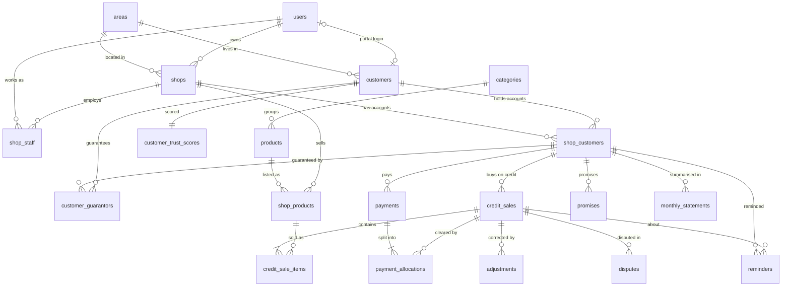
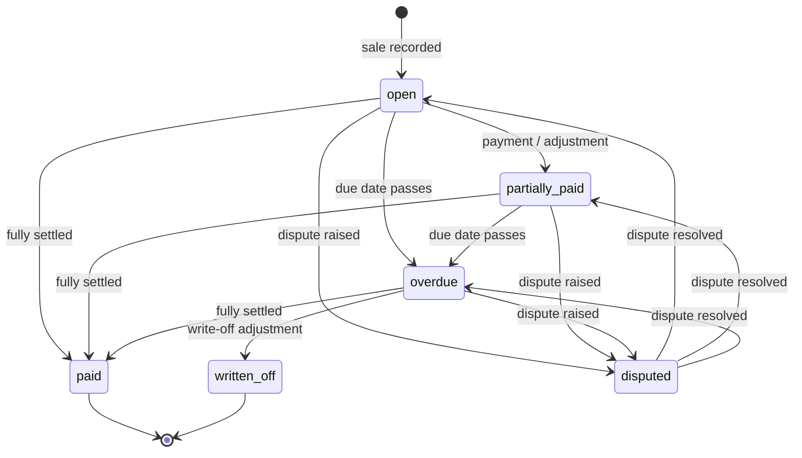

# DokanKhata

**Intelligent Baki Management & Credit Tracking Infrastructure for Small Retailers**

DokanKhata digitizes the paper *baki khata* (credit notebook) kept by small shops across Bangladesh. Shopkeepers record credit sales, take payments in cash or by mobile banking, send due reminders and check a **cross-shop trust score** before giving credit to a customer.

This repository currently contains the **database layer**: a MariaDB/MySQL schema that enforces the business rules itself, through constraints, triggers, stored procedures and scheduled events. Any frontend or API built on it gets the same guarantees.


---

## Table of contents

- [Highlights](#highlights)
- [Repository layout](#repository-layout)
- [Quick start](#quick-start)
- [Data model](#data-model)
- [Tables](#tables)
- [Views](#views)
- [Stored procedures](#stored-procedures)
- [Triggers](#triggers)
- [Scheduled events](#scheduled-events)
- [Sale status lifecycle](#sale-status-lifecycle)
- [Trust score](#trust-score)
- [Usage examples](#usage-examples)
- [Testing](#testing)
- [Naming conventions](#naming-conventions)

---

## Highlights

- **Ledger you can't edit.** Credit sales and payments can never be deleted, and their amounts can't be changed. A mistake is corrected with an *adjustment* (return, discount, correction or write-off), so the full history is always kept.
- **Credit-limit enforcement.** A sale that would push a customer past their limit, or that is made on a blocked account, is refused by the database.
- **Race-safe transactions.** The sale and payment procedures lock the customer's account row (`SELECT … FOR UPDATE`), so two counters can't both pass the credit-limit check at the same moment.
- **Server-side pricing.** Item prices always come from the shop's own price list. The frontend only sends product IDs and quantities.
- **FIFO payment allocation.** Each payment clears the oldest unpaid sale first. Disputed sales are skipped.
- **Stock tracking.** Selling an item lowers its stock, and a sale is refused if there isn't enough. Shops that don't count stock, like a tea stall, can turn this off per product.
- **Cross-shop trust score (0–100).** Rebuilt every night from a customer's history at **every** shop, using one customer identity keyed by phone number.
- **Promises, disputes and guarantors.** Covers "I'll pay on the 5th" (*promises*), customer disputes, and a *jamindar* (another customer who guarantees the account).
- **Automated nightly jobs.** Marks sales overdue, settles promises, queues SMS reminders, refreshes trust scores and generates monthly statements.
- **Audit trail.** Every change to a customer's credit limit, due days or account status is logged, along with who made it.
- **Bangladesh-specific validation.** Mobile numbers must match `01[3-9]XXXXXXXX`, NIDs must be 10, 13 or 17 digits, areas use the 8 divisions, and payments accept cash, bKash, Nagad and Rocket (mobile payments need a TrxID).

---

## Repository layout

```
db/
└── database/
    ├── schema.sql            # tables, views, procedures, triggers, events
    ├── seed.sql              # ~5 months of realistic sample data
    ├── dokankhata_full.sql   # schema.sql + seed.sql in one file
    └── test_schema.sql       # smoke test for every rule and procedure
```

| At a glance | Count |
|---|---|
| Tables | **21** (in 5 modules) |
| Views | **6** |
| Stored procedures | **7** |
| Triggers | **13** |
| Scheduled events | **5** |

---

## Quick start

### Requirements

- [XAMPP](https://www.apachefriends.org/) with **MariaDB 10.4 or newer** (or any MariaDB 10.4+ server)
- phpMyAdmin, or the `mysql` command-line client

> ⚠️ Importing `schema.sql` or `dokankhata_full.sql` **drops and recreates** the `dokankhata` database.

### Option A: everything in one file (recommended)

1. Start **Apache** and **MySQL** in the XAMPP Control Panel.
2. Open <http://localhost/phpmyadmin>.
3. Click **Import** at the top **without** selecting a database first.
4. Choose `db/database/dokankhata_full.sql` and click **Go**.

### Option B: schema and data separately

1. Import `db/database/schema.sql` from the server level, as above.
2. Select the `dokankhata` database, then import `db/database/seed.sql`.

### Command line

```bash
mysql -u root -p < db/database/dokankhata_full.sql
```

### Keep the event scheduler on

The nightly jobs need MariaDB's event scheduler. `schema.sql` turns it on, but XAMPP turns it off again on every restart. To keep it on, add this under `[mysqld]` in your config file:

```ini
event_scheduler=ON
```

- **Windows:** `C:\xampp\mysql\bin\my.ini`
- **macOS:** `/Applications/XAMPP/xamppfiles/etc/my.cnf`

### Demo logins

Every seeded user has the password **`dokan123`**. The hashes are real PHP `password_hash()` (bcrypt) output.

| Role | Name | Phone | Notes |
|---|---|---|---|
| Admin | Tanvir Ahmed | `01927948204` | `tanvir.ahmed@example.com` |
| Owner | Rahim Uddin | `01534490777` | Rahim General Store |
| Manager | Jamal Hossain | `01568634607` | Rahim General Store |
| Customer | Mohammad Jahangir Gazi | `01302642668` | Customer portal |

### What the sample data contains

Roughly five months of activity across **9 shops in 7 areas**: 107 customers holding 133 shop accounts, 1,588 credit sales, 1,266 payments (cash, bKash, Nagad, Rocket), plus returns, discounts, disputes, promises, write-offs and SMS reminders.

Every date is stored **relative to the day you import** (for example `@today - INTERVAL 12 DAY`), so "overdue", "due tomorrow" and "promised for Friday" always line up with the real calendar.

---

## Data model



### Key design ideas

- **One customer, many shops.** `customers` holds a single identity per phone number. `shop_customers` is that person's *account* at a particular shop, with its own credit limit, due days and status. This is what makes cross-shop trust scoring possible.
- **One shared product catalog.** `products` is shared by every shop. `shop_products` holds each shop's own price, stock and reorder level.
- **Prices are frozen at sale time.** `credit_sale_items.unit_price` is copied from the price list when the sale is made, so later price changes don't rewrite old bills.
- **Balances are calculated, not stored.** A sale's balance is always `total − allocations − adjustments`, computed by the views, so there is no running total that can drift out of sync.

---

## Tables

### Module A: Platform & access

| Table | Purpose |
|---|---|
| `areas` | Location hierarchy (area → thana → district → division) for area-wise risk reports. |
| `users` | One login table for every role: `owner`, `staff`, `customer`, `admin`. Passwords are stored only as bcrypt hashes. |
| `shops` | Registered shops. A shop starts as `pending` and an admin must verify it before it goes live. Holds the default credit limit (Tk 5,000) and due days (15). |
| `shop_staff` | Which users work at which shop (`manager` / `cashier`), and whether each one may give credit. |

### Module B: Customers

| Table | Purpose |
|---|---|
| `customers` | One identity per person across all shops, keyed by phone. Optional NID and portal login. |
| `shop_customers` | A customer's account at one shop: credit limit, due days (1–90), and status (`active` / `blocked` / `closed`). Blocking requires a reason. |
| `customer_guarantors` | A *jamindar*: another customer of the same shop who guarantees the account up to a set limit. |
| `customer_trust_scores` | One score (0–100) per customer, with its components, rebuilt every night. |

### Module C: Products

| Table | Purpose |
|---|---|
| `categories` | Product groups (rice & grains, oil, medicine …), with Bangla names. |
| `products` | Shared catalog. Loose goods (rice, dal, onion) use the brand `Loose`. Units include kg, litre, piece, strip, bottle and more. |
| `shop_products` | A shop's price list and stock. `track_stock = 0` turns stock checks off for that product. |

### Module D: Credit ledger

| Table | Purpose |
|---|---|
| `credit_sales` | One *baki* purchase, with its total, due date and status. Can't be deleted, and its amount can't be edited. |
| `credit_sale_items` | The lines of a sale. `line_total` is a persistent generated column. |
| `payments` | Money paid into an account: `cash`, `bkash`, `nagad` or `rocket`. Mobile payments need a unique TrxID. |
| `payment_allocations` | Which payment cleared which sale, and how much. Filled oldest-sale-first (FIFO). |
| `adjustments` | The only way to correct a sale: `return`, `discount`, `correction` or `write_off`. |
| `promises` | "I'll pay Tk 2,000 on the 5th." Marked `kept` or `broken` every night. |
| `disputes` | A customer contests a sale. Only **one open dispute per sale** is allowed, enforced with a unique key on a generated column. |

### Module E: Communication & records

| Table | Purpose |
|---|---|
| `reminders` | Queue of SMS/app reminders (`before_due`, `on_due`, `overdue`, `promise`). A unique key on (sale, type) prevents duplicates. |
| `monthly_statements` | A frozen month-end summary per account. A CHECK guarantees `closing = opening + credit − paid − adjustments`. |
| `audit_log` | Who changed what and when, stored as JSON. It has no foreign keys, so log entries outlive the rows they describe. |

---

## Views

| View | What it returns |
|---|---|
| `v_sale_amounts` | Every sale with its paid amount, adjusted amount and last payment time. Uses correlated subqueries to avoid row multiplication. |
| `v_sale_balance` | `v_sale_amounts` plus `balance` and `days_overdue`. Most other views and procedures build on this one. |
| `v_customer_balance` | One row per account: total credit, paid, adjusted, balance, **available credit**, unpaid sales, oldest unpaid due date and max days overdue. |
| `v_shop_outstanding` | Per shop: how many customers owe money, the total outstanding and how much of it is overdue. |
| `v_customer_exposure` | One customer's **total debt across all shops**, and how many shops they owe. |
| `v_aging` | Each shop's receivables split by lateness: not yet due, 1–30, 31–60, 61–90 and 90+ days. |

---

## Stored procedures

| Procedure | Description |
|---|---|
| `sp_record_credit_sale(account, staff, items_json, note, OUT sale_id)` | Records a sale and all its items in **one transaction**. Checks that the staff member may give credit, prices every item from the shop's list, and lets the triggers enforce the credit limit and stock. |
| `sp_record_payment(account, amount, method, trx_ref, received_by, OUT payment_id)` | Records a payment and allocates it FIFO across unpaid, undisputed sales. Refuses overpayments and duplicate TrxIDs. |
| `sp_add_adjustment(sale, type, amount, reason, approved_by, OUT adjustment_id)` | Applies a return, discount, correction or write-off. Only the shop owner or a manager can approve one, and it can't exceed the sale balance. |
| `sp_refresh_sale_status(sale_id)` | Works out a sale's status from its numbers. Called by triggers. |
| `sp_calculate_trust_score(customer_id)` | Recalculates one customer's score from their history at all shops. |
| `sp_refresh_all_trust_scores()` | Loops over every customer with a cursor and recalculates each score. |
| `sp_generate_statements(month)` | Builds or rebuilds month-end statements for every account that has had any credit up to the end of that month. Safe to run more than once. |

---

## Triggers

| # | Trigger | Rule |
|---|---|---|
| T1 | `trg_credit_sales_bi` | Refuses credit on a blocked or closed account, or above the credit limit. |
| T2 | `trg_credit_sales_bu` | The amount, customer, staff and date of a sale can't be edited. A due date can only be **extended**. |
| T3 | `trg_credit_sales_bd` | Sales can't be deleted. |
| T4 | `trg_credit_sale_items_bi` | The item must belong to the sale's shop and there must be enough stock. Then the stock is lowered. |
| T5 | `trg_payments_bu` | A payment's money fields can't be edited. |
| T6 | `trg_payments_bd` | Payments can't be deleted. |
| T7 | `trg_payment_allocations_bi` | An allocation must stay within both the payment and the sale balance, and both must belong to the same account. |
| T8 | `trg_payment_allocations_ai` | Refreshes the sale's status after money is allocated. |
| T9 | `trg_adjustments_ai` | Refreshes the sale's status after an adjustment. |
| T10 | `trg_disputes_ai` | Marks the sale `disputed`. |
| T11 | `trg_disputes_au` | Restores the sale's normal status when the dispute is resolved. |
| T12 | `trg_customer_guarantors_bi` | A customer can't guarantee themselves, and the guarantor must be a customer of the same shop. |
| T13 | `trg_shop_customers_au` | Logs every change to a credit limit, due days or account status in `audit_log`. |

> **Bulk loading:** the checking and bookkeeping triggers skip their work while the session variable `@disable_triggers` is set. `seed.sql` uses this to load already-validated history quickly. Normal use never sets it.

---

## Scheduled events

| Event | Runs | What it does |
|---|---|---|
| `ev_mark_overdue` | Daily, 00:05 | Marks unpaid sales past their due date as `overdue`. |
| `ev_check_promises` | Daily, 00:10 | Marks a promise `kept` if enough was paid by the promised date, otherwise `broken` once the date passes. |
| `ev_queue_reminders` | Daily, 00:15 | Queues SMS reminders 1–3 days before the due date, on the due date, and once a sale is 7+ days late. |
| `ev_trust_scores` | Daily, 00:30 | Calls `sp_refresh_all_trust_scores()`. |
| `ev_monthly_statements` | 1st of each month, 01:00 | Generates statements for the month that just ended. |

---

## Sale status lifecycle



Status is never set by hand. `sp_refresh_sale_status` works it out from the sale's numbers, in this order of priority: **disputed → written_off → paid → overdue → partially_paid → open**.

---

## Trust score

Each customer gets a score from **0 to 100**, calculated from their history at **every** shop:

```
score = on-time % of settled sales in the last 12 months   (60 if none yet)
      − min(avg days late, 30)          × 0.8   →  up to −24
      − min(broken promises*, 5)        × 4     →  up to −20
      − min(extra shops owed, 3)        × 5     →  up to −15
      − min(currently overdue sales, 5) × 3     →  up to −15
      − min(write-offs, 3)              × 10    →  up to −30

* broken promises from the last 180 days
```

The result is rounded and clamped to 0–100. Each component is saved next to the score in `customer_trust_scores`, so the app can explain *why* a customer scored the way they did.

---

## Usage examples

**Record a credit sale.** The frontend sends only product IDs and quantities:

```sql
CALL sp_record_credit_sale(
  1,                                   -- shop_customer_id
  2,                                   -- staff_user_id
  '[{"shop_product_id": 12, "qty": 5},
    {"shop_product_id": 40, "qty": 2}]',
  'Weekly groceries',
  @sale_id);
SELECT @sale_id;
```

**Take a bKash payment:**

```sql
CALL sp_record_payment(1, 800.00, 'bkash', 'BK8X2LQ9ZP', 2, @payment_id);
```

**Approve a return:**

```sql
CALL sp_add_adjustment(@sale_id, 'return', 120.00, 'Damaged oil bottle returned', 1, @adj_id);
```

**Check a customer before giving credit:**

```sql
SELECT balance, available_credit, max_days_overdue
FROM   v_customer_balance WHERE shop_customer_id = 1;

SELECT e.shops_owed, e.total_outstanding, t.score
FROM   v_customer_exposure e
JOIN   customer_trust_scores t USING (customer_id)
WHERE  e.phone = '01302642668';
```

**Aging report for a shop:**

```sql
SELECT * FROM v_aging WHERE shop_id = 1;
```

**Record who made a change** (so `audit_log` shows a real name):

```sql
SET @app_user = 'rahim';
UPDATE shop_customers SET credit_limit = 4000 WHERE shop_customer_id = 1;
```

---

## Testing

`db/database/test_schema.sql` is a smoke test for every procedure, trigger and rule. Run it on a **freshly imported, empty** schema:

1. Import `schema.sql`.
2. In phpMyAdmin → `dokankhata` → **SQL**, paste **Part 1** (minimal data) and **Part 2** (normal use), then press **Go**. Compare the results with the `EXPECT:` comments.
3. Paste the **Part 3** tests **one at a time**. Each one is supposed to **fail** with the error message shown, for example:
   - `Credit limit exceeded: owes Tk 0.00, this sale Tk 2400.00, limit Tk 2000.00`
   - `Not enough stock: Farm egg (1.00 left)`
   - `This transaction ID has already been recorded`
   - `Ledger rows cannot be deleted; add an adjustment instead`
   - `A customer cannot be their own guarantor`
4. Import `schema.sql` again before loading `seed.sql`.

---

## Naming conventions

| Object | Pattern | Example |
|---|---|---|
| Table | `snake_case`, plural | `credit_sales` |
| Primary key | `<singular>_id` | `sale_id` |
| Foreign key | `fk_<table>_<column>` | `fk_credit_sales_staff` |
| Unique key | `uk_<table>_<columns>` | `uk_payments_trx_ref` |
| Check | `ck_<table>_<rule>` | `ck_payments_amount` |
| Index | `idx_<table>_<columns>` | `idx_credit_sales_status_due` |
| View | `v_<name>` | `v_customer_balance` |
| Trigger | `trg_<table>_<bi\|bu\|bd\|ai\|au>` | `trg_credit_sales_bi` |
| Procedure | `sp_<verb>_<noun>` | `sp_record_payment` |
| Event | `ev_<job>` | `ev_mark_overdue` |
